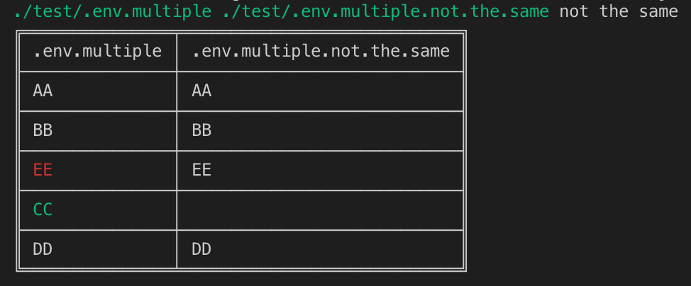

# guardian-of-env

[](https://github.com/hermeslin/guardian-of-env/actions/workflows/ci.yml)
[](https://www.npmjs.com/package/guardian-of-env)
[](https://renovatebot.com/)

## Screenshot



## Installation

```sh
yarn add guardian-of-env --dev
```

## Configuration

in your project folder, execute `guardian-of-env`, and `guardian-of-env` compares `.env` and `.env.example` file by default.

```sh
npx guardian-of-env
```

or set more files that you want to compare

```
npx guardian-of-env .env .env.example .env.exmaple.example
```

## Work with pre-commit

install `pre-commit` first, and follow the configuration of package.json below

```js
{
    "scripts": {
        "guardian-of-env": "guardian-of-env"
    },
    "pre-commit": [
        "guardian-of-env"
    ],
}
```

## Work with CI

or you want to compare your .env files in the ci phase

### package.json

```js
{
    "scripts": {
        "guardian-of-env": "./node_modules/.bin/guardian-of-env .env .env.test"
    },
}
```

### GitHub Actions (`.github/workflows/ci.yml`)

```yml
steps:
  - uses: actions/checkout@v7
  - uses: actions/setup-node@v7
    with:
      node-version: '22.x'
  - run: yarn install --frozen-lockfile
  - run: yarn guardian-of-env
```

## Development

Run lint, the format check, the type check and the tests (`npm run check`) inside Docker, isolated from the Node.js and npm installed on your machine (requires Docker with Compose v2):

```sh
# Node.js 22 (default)
docker compose run --rm --build test

# another Node.js version, e.g. 24
NODE_VERSION=24 docker compose run --rm --build test
```

Dependencies are installed inside the image from `package-lock.json`; your local `node_modules` is never used.
